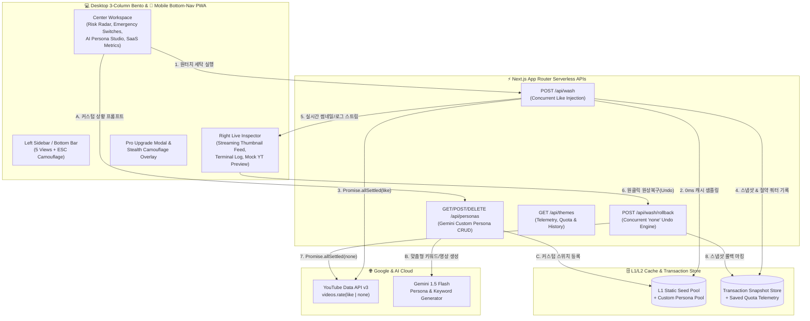
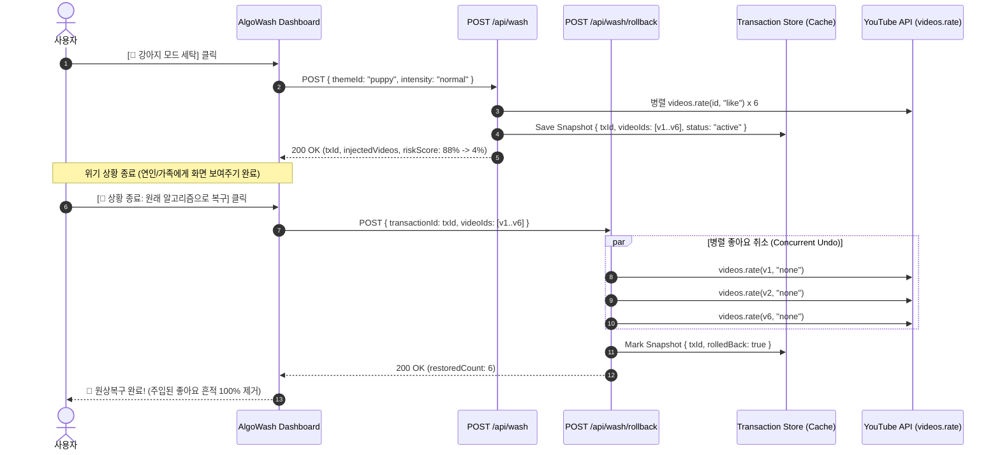

# 🏗️ ARCHITECTURE.md (AlgoWash v2.0 Hybrid SaaS & Rollback Architecture)

> **문서 목적 (v2.0)**: 데스크톱 3단 Bento Grid와 모바일 하단 탭바를 아우르는 하이브리드 UI 구조, 실시간 스트리밍 피드백, 트랜잭션 롤백(`rating='none'`) 엔진, 그리고 엔지니어링 텔레메트리 아키텍처를 정의한다.

---

## 1. v2.0 전체 시스템 아키텍처 (Hybrid Bento + Serverless Core)

---

## 2. 트랜잭션 스냅샷 & 원클릭 롤백(Undo) 시퀀스

위기 상황이 종료된 후 사용자의 원래 알고리즘 취향이 망가지지 않도록, 주입했던 신호를 정확히 역추적하여 `rating='none'`으로 중화합니다.

---

## 3. 엔지니어링 텔레메트리 산식 (Observability Metrics)

포트폴리오 심사자 및 사용자에게 아키텍처의 효율성을 증명하기 위해 캐시 레이어(`src/lib/cache.ts`)에서 다음 지표를 실시간 계산합니다:
- **절약한 `search.list` 쿼터 (`savedSearchUnits`)**: 매 세탁 또는 프리셋 조회 시 실시간 검색(`100 units` + 영상 상세 조회) 대신 L1/L2 캐시 풀을 사용한 횟수 × `100 units`.
- **캐시 적중률 (`cacheHitRate`)**: `cacheHits / (cacheHits + cacheMisses) * 100` (L1 정적 시드 풀 보장으로 99%+ 유지).
- **평균 병렬 처리 레이턴시 (`avgLatencyMs`)**: 직렬 호출 대비 `Promise.allSettled` 팬아웃으로 단축된 실제 처리 시간 추적.
